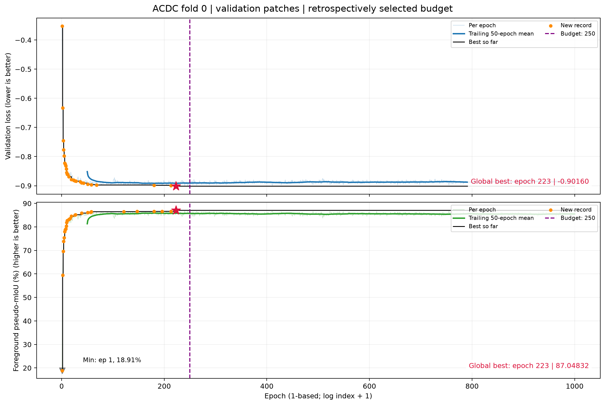
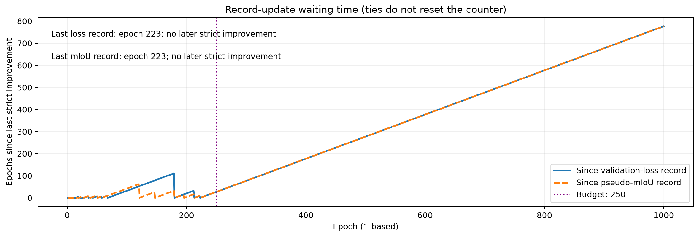

# ACDC epoch 선택 근거

## 관찰
- 분석 대상: ACDC fold 0, 완료 1000 epoch. 번호는 1-based입니다.
- Validation loss 최솟값: **-0.9016**, **223번째 epoch** (로그 index 222).
- Foreground pseudo-mIoU 최댓값: **87.0483%**, **223번째 epoch**.
- Pseudo-mIoU 최솟값(참고): 18.9084%, 1번째 epoch.
- 마지막 최고 기록 갱신 이후 학습 종료까지 loss는 **777 epoch**, mIoU는 **777 epoch** 동안 엄격한 개선이 없었습니다.
- 후보 250 epoch 시점에서는 각각 27 / 27 epoch 동안 갱신이 없었습니다. 이 시점에는 이후 결과를 알 수 없었으므로, 위 종료 시점의 대기 길이를 온라인 판단 근거로 사용하면 안 됩니다.

## 제한된 예산의 후보
공통 예산 후보는 **250 epoch × 250 step = 62,500회 업데이트**입니다.
기록된 epoch 시간 합계는 후보까지 약 **4.88시간**, 전체 약 **19.49시간**이며 약 **75.0%** 절감에 해당합니다. 최종 추론·평가·준비 시간은 제외합니다.

후보의 타당성은 아래 구간 평균과 최고 기록 갱신 위치를 함께 보고 판단합니다. 그래프가 후보를 자동으로 최적이라고 증명하는 것은 아닙니다.

## 한계와 비교 조건
- 지표는 패치 기반 pseudo-mIoU이며 전체 영상 mIoU가 아닙니다. 클래스별 반올림된 Dice를 각각 IoU로 변환 후 평균했습니다.
- 단일 baseline/fold의 사후 분석입니다. 다른 모델의 수렴 시점이나 250 epoch에서의 최종 볼륨 성능을 보장하지 않습니다.
- 총 epoch를 변경하면 polynomial 학습률 일정도 달라집니다. 짧은 일정의 baseline을 별도로 확인해야 합니다.
- 기준 metric과 checkpoint 선택 정책을 구분하세요. 기존 checkpoint_best는 EMA pseudo-Dice 기준이며, 여기서 계산한 최소 loss/최대 mIoU epoch의 가중치가 보존되어 있다는 뜻은 아닙니다.
- 기존 학습의 split/checkpoint를 변경하거나 재학습하지 않았습니다.

## 그래프

## 50 epoch 구간 평균
| Epoch | Mean val loss | Mean pseudo-mIoU (%) |
|---|---:|---:|
| 1–50 | -0.851644 | 81.3513 |
| 51–100 | -0.890294 | 85.7077 |
| 101–150 | -0.889828 | 85.6515 |
| 151–200 | -0.891228 | 85.7940 |
| 201–250 | -0.891170 | 85.7902 |
| 251–300 | -0.890076 | 85.7035 |
| 301–350 | -0.888968 | 85.6301 |
| 351–400 | -0.888018 | 85.5287 |
| 401–450 | -0.889178 | 85.7347 |
| 451–500 | -0.887292 | 85.4817 |
| 501–550 | -0.887498 | 85.5185 |
| 551–600 | -0.887860 | 85.5869 |
| 601–650 | -0.887770 | 85.5822 |
| 651–700 | -0.887146 | 85.5020 |
| 701–750 | -0.885692 | 85.3907 |
| 751–800 | -0.887976 | 85.6007 |
| 801–850 | -0.886564 | 85.4440 |
| 851–900 | -0.886696 | 85.4905 |
| 901–950 | -0.886190 | 85.5007 |
| 951–1000 | -0.886082 | 85.5052 |
