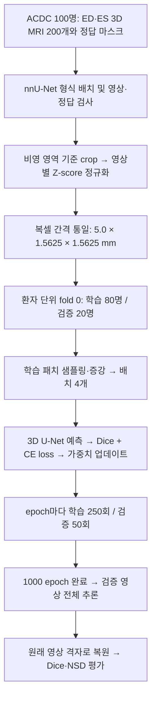

## 원본 데이터에서 학습·평가까지

아래는 이번 실행에 저장된 `nnUNetPlans.json`, `debug.json`, 환자 분할 및 실행 코드에 근거한 과정입니다. 크기와 간격은 별도 표시가 없으면 **z, y, x 순서**입니다. ED/ES는 한 환자의 서로 다른 심장 주기 영상이며, 시간축을 가진 4D 영상을 그대로 모델에 넣는 구성은 아닙니다.



### 1. 원본 선택과 nnU-Net 형식 변환

공식 ACDC training 환자 100명에서 **ED(이완기 말)·ES(수축기 말)의 3D MRI 각 1개와 해당 정답 마스크**만 사용했습니다. 총 영상 200개와 마스크 200개이며, 전체 심장 주기를 담은 `_4d` cine 영상과 별도 testing 환자는 사용하지 않았습니다. 이 단계는 사용할 파일을 선택하고 이름을 맞추는 과정으로, 영상 해상도를 줄이지 않습니다.

- 입력: `imagesTr/patientXXX_frameYY_0000.nii.gz` — MRI 단일 채널.
- 정답: `labelsTr/patientXXX_frameYY.nii.gz` — background=0, RV=1, MLV=2, LVC=3.
- 영상·정답 쌍, 개수, label 값, 배열 크기와 공간 정보를 검사합니다.
- ACDC의 sform/qform 차이는 SimpleITK의 좌표 해석을 사용합니다. 평가에서도 같은 읽기 방식을 쓰며 실제 좌표 불일치는 오류 처리합니다.

### 2. 전처리: 여백·밝기·복셀 간격을 정리

`DefaultPreprocessor`가 영상과 정답을 함께 처리하고, 복원에 필요한 원래 크기·간격·crop 위치를 보관합니다.

| 순서 | 이번 실행에서 수행한 처리 | 목적 |
|---|---|---|
| 읽기·축 정리 | SimpleITK로 읽어 z,y,x 배열로 사용. 계획의 추가 축 교환은 `[0,1,2]` | 일관된 축 순서 유지 |
| Crop | 영상의 비영(nonzero) 영역을 감싸는 상자로 잘라 영상과 정답에 동일 적용 | 불필요한 바깥 여백 감소. 정답 심장만 잘라내는 방식은 아님 |
| 밝기 정규화 | 잘라낸 각 MRI의 `(값 − 평균) / 표준편차`로 Z-score 정규화 | 영상마다 다른 밝기 범위 완화 |
| Resampling | 영상과 정답의 복셀 간격을 **`[5.0, 1.5625, 1.5625] mm`**로 통일 | 서로 다른 공간 해상도를 동일 기준으로 처리 |
| 저장 | 전처리 배열·공간 메타데이터·전경 샘플링 정보를 저장 | 학습 시 패치를 빠르게 읽고 최종 예측을 복원 |

정규화는 **resampling 전에** 수행합니다. 이번 계획은 `use_mask_for_norm=false`이므로 crop 이후 영상 전체의 평균·표준편차를 사용하며, 정답 심장 영역만으로 밝기를 정규화하지 않습니다. 정답의 정수 label에는 밝기 정규화를 적용하지 않습니다.

원본의 중앙 복셀 간격은 `[10.0, 1.5625, 1.5625] mm`이고 목표 간격은 `[5.0, 1.5625, 1.5625] mm`입니다. 즉, 모든 축을 줄이는 다운샘플링이 아니라 **대표적으로 z축 간격을 좁혀 보간하는 처리**입니다. 보간으로 실제 촬영 정보가 새로 생기는 것은 아닙니다. 계획상 전처리 후 중앙 크기는 약 `[18, 237, 208]`이며, 환자별 최종 배열 크기는 다를 수 있습니다.

영상은 연속 밝기값, 정답은 클래스 번호이므로 서로 다른 resampling 처리를 사용합니다. 계획에는 영상 `order=3`, 정답 `order=1`의 label-aware 처리, 별도 저해상도 축 처리 시 `order_z=0`이 기록되어 있습니다. 따라서 정답 클래스 번호 자체를 일반 영상처럼 연속 값으로 보간하는 방식이 아닙니다.

### 3. 환자 단위로 학습·검증 분리

고정된 5-fold 분할(seed 1234) 중 이번에는 **fold 0 하나**를 실행했습니다. 학습은 80명·160영상, 검증은 20명·40영상입니다. 같은 환자의 ED와 ES를 반드시 같은 그룹에 넣어 한 환자가 학습과 검증 양쪽에 들어가지 않게 했습니다. 준비된 200개 영상을 모두 학습에 사용하는 것은 아닙니다.

### 4. 패치를 배치로 묶어 모델 학습

학습 시 전처리 영상에서 **`[20, 256, 224]` 복셀 크기의 3D 패치**를 샘플링합니다. 영상이 패치보다 작은 축에는 padding을 사용합니다. 이 데이터에서는 패치가 영상 전체에 가까운 범위를 덮을 수도 있습니다. 서로 다른 패치가 반드시 서로 다른 환자를 의미하지는 않습니다.

전경이 포함된 패치를 의도적으로 뽑는 설정(`oversample_foreground_percent=0.33`)과 일반 무작위 샘플링을 함께 사용합니다. 실제 배치 내 개수는 정수 단위로 결정되므로 매번 정확히 33%라는 뜻은 아닙니다. 회전·확대/축소·반전과 밝기·대비·감마·노이즈 등의 증강을 학습 중 적용합니다. 공간 변환은 영상과 정답에 함께 적용하고 밝기 변환은 영상에만 적용합니다.

**실제 batch size는 4**입니다. 증강 후 입력 텐서의 크기는 `[4, 1, 20, 256, 224]`로, 순서대로 배치·채널·z·y·x입니다.

```text
MRI 패치 4개 + 대응 정답 4개
  → 3D U-Net이 배경·RV·MLV·LVC 예측
  → 예측과 정답으로 Dice loss + Cross-Entropy loss 계산
  → 역전파
  → optimizer가 모델 가중치를 1번 업데이트 (= 1 iteration)
```

모델은 6단계 encoder를 가진 `PlainConvUNet`이며 encoder와 decoder의 skip connection을 사용합니다. 채널 수는 `[32,64,128,256,320,320]`이고, 여러 해상도의 decoder 출력에도 loss를 주는 **deep supervision**을 사용했습니다. 저장된 optimizer는 **SGD, 초기 학습률 0.01, momentum 0.99, Nesterov=True, weight decay 3e-5**입니다. 학습률은 1,000 epoch 일정에 맞춰 polynomial 방식으로 감소합니다.

### 5. Epoch별 검증과 최종 평가

| 단위 | 이번 실행의 의미 |
|---|---|
| 1 iteration | 패치 4개를 입력하고 가중치 1번 업데이트 |
| 1 epoch | 학습 250 iterations → 검증 50 iterations → loss 기록 |
| 학습 1,000 epochs | 총 250,000번 업데이트, 학습 패치 처리량 1,000,000개 |

패치 처리량은 반복 샘플링과 증강을 포함하며, 고유 영상이나 환자 수가 아닙니다. **nnU-Net의 epoch는 전체 학습 영상을 정확히 한 번씩 순회하는 단위가 아닙니다.** 검증 단계에서는 가중치를 업데이트하지 않습니다. 그래프의 Validation loss는 매 epoch 검증 패치로 계산한 값입니다.

학습 종료 후에는 **최종 checkpoint**로 검증 영상 40개 전체를 sliding-window 방식으로 예측합니다. 겹치는 패치의 예측을 합치고 기본 test-time mirroring을 사용한 뒤, 전처리 때의 공간 정보를 이용해 원래 영상 격자로 복원합니다. 이 정상적인 추론 복원과 별개로, 평가 코드가 좌표 불일치를 숨기기 위해 임의 resampling을 하지는 않습니다.

아래 보고서의 Dice·NSD는 이렇게 저장된 **전체 영상 예측과 원본 정답**을 비교한 결과입니다. 매 epoch의 패치 기반 loss나 pseudo Dice와는 구분해야 합니다. 최종 평가는 추가 모델 앙상블·후처리 없이 수행했습니다.

근거: [저장된 계획](artifacts/runs/acdc-baseline-v1/nnUNetPlans.json), [학습 초기 설정](artifacts/runs/acdc-baseline-v1/nnUNet_results/Dataset027_ACDC/nnUNetTrainer__nnUNetPlans__3d_fullres/fold_0/debug.json), [환자 분할](artifacts/runs/acdc-baseline-v1/splits_final.json), [전처리 코드](../../../nnunetv2/preprocessing/preprocessors/default_preprocessor.py), [학습 코드](../../../nnunetv2/training/nnUNetTrainer/nnUNetTrainer.py). 저장된 계획·설정은 해당 실행의 기록이며 코드 링크는 현재 checkout을 가리킵니다.
